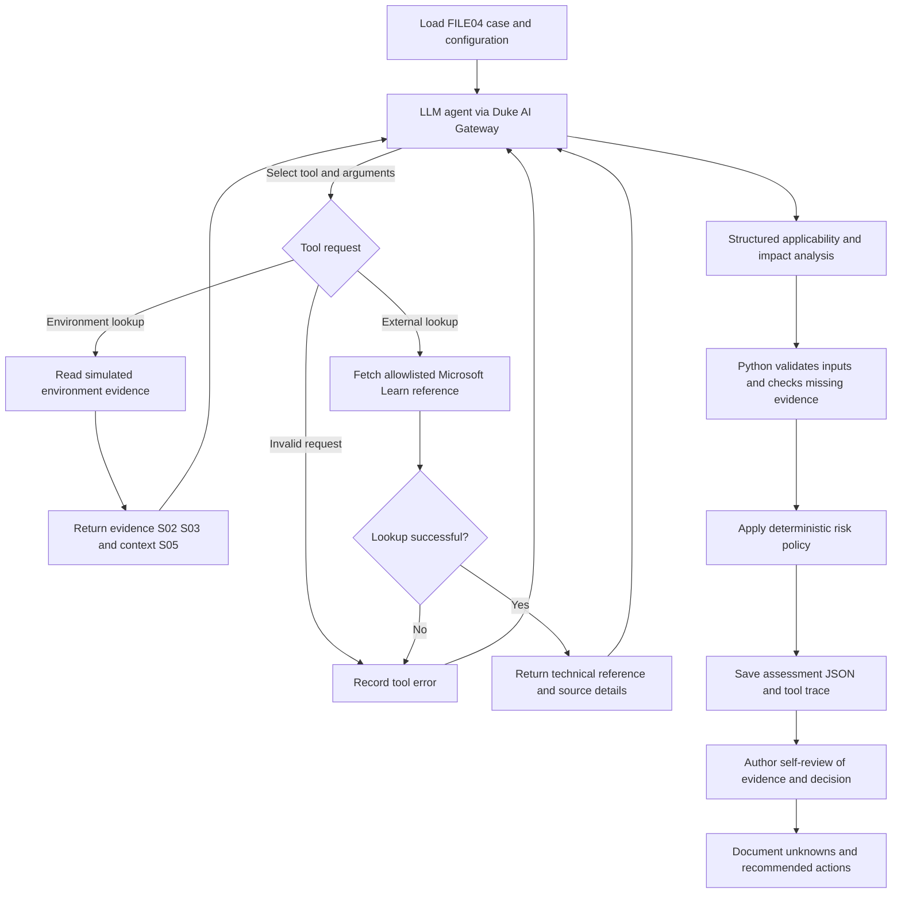

# Agent Architecture

## 1. Risk Question

Does FILE04's SMB signing configuration create a meaningful SMB relay risk in the simulated Northbridge Services environment?

FILE04 is a Windows Server 2022 file server in the W05 group. SMB signing is not required on this server, but the environment does not provide enough information to confirm an SMB relay attack path.

## 2. Architecture Diagram

The workflow diagram is saved in [architecture.mmd](architecture.mmd). It shows how the model requests tools, how Python handles the results, and where the final risk decision is made.

## 3. How the Agent Works

1. The program loads the case from `data/threat_input.json` and connects to the Duke AI Gateway.
2. The LLM selects tool calls using `tool_choice=auto`.
3. Python runs `lookup_environment` for simulated asset evidence and `lookup_external_reference` for the Microsoft SMB signing documentation.
4. Tool results are returned to the model. The model uses them to explain applicability, impact, and missing information.
5. Python checks the model output and applies the risk policy in `src/risk_policy.py`. The model does not choose the final risk rating by itself.
6. The program saves the assessment and tool trace. I then review the evidence and the result separately.

## 4. Evidence and Tools

| Tool | Purpose | If It Fails |
|---|---|---|
| `lookup_environment(asset_id)` | Find FILE04 and its simulated evidence | Return a missing-asset result instead of guessing |
| `lookup_external_reference(url)` | Retrieve the approved Microsoft Learn reference | Record the failure and avoid a confident rating |

The environment data is reconstructed from the course document dated September 23, 2026. S02 describes network restrictions, S03 describes the SMB signing setting, and S05 gives general business impact context. The Microsoft reference explains SMB signing but does not prove that FILE04 is exploitable.

## 5. Risk Decision

The model returns separate values for applicability and impact. Python validates those values and applies the project policy.

The saved live baseline produced:

- **Applicability:** `potential`
- **Impact:** `unknown`
- **Decision:** `Insufficient Evidence`
- **Rule:** `P1`

This result makes sense because internal SMB reachability, NTLM relay prerequisites, effective SMB signing, and FILE04-specific business impact are still unknown.

## 6. Testing and Review

The project has a saved live Duke Gateway baseline, 11 passing unit tests, and six passing mocked end-to-end scenarios. The mocked tests check the workflow under controlled conditions; they are not six additional live model runs.

I completed an individual evidence self-review. The details are in [HUMAN_REVIEW.md](HUMAN_REVIEW.md), and the test results are in [TESTING.md](TESTING.md).

## 7. Limitations

This is a simulated environment, not a live network assessment. No exploitation or penetration testing was performed. The result should be updated if new information becomes available about FILE04's network access, authentication settings, or shared files.
