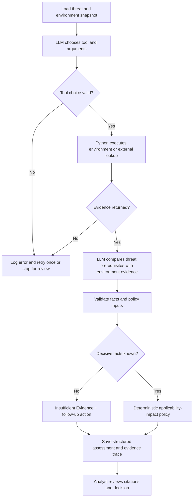

# Step 1 — Proposed Architecture

## Risk question
Does FILE04's nonmandatory SMB signing create meaningful SMB relay risk given prerequisites, access paths, controls, and business impact?

## Scope and sources
Target FILE04 within W05, Northbridge Services fictional snapshot (2026-09-23). The supplied Word document supports S01, S02, S03 and S05. Our JSON is a **partial reconstruction**, not the missing canonical JSON. Unknown details remain null. External source: Microsoft SMB signing overview (URL in threat_input.json), to be retrieved and reviewed during the completed agent run.

## Planned workflow

## Tool contracts
- `lookup_environment(asset_id: str) -> dict`: returns asset, matching evidence IDs, simulated mode and snapshot date; missing IDs return `not_found`.
- `lookup_external_reference(url: str) -> dict`: allowlisted Microsoft SMB signing page; returns bounded page excerpt and URL on success, `unavailable` on timeout/network error, `blocked` for disallowed URL. Raw HTML must be parsed/validated before factual use.

## Rating policy (proposed)
Applicability is `confirmed`, `potential`, `not_applicable`, or `unknown`; impact is `high`, `medium`, `low`, or `unknown`. A missing decisive fact returns Insufficient Evidence, except confirmed non-applicability -> Low. Confirmed applicability: high/medium impact -> High, low impact -> Medium. Potential applicability: high/medium impact -> Medium, low impact -> Low. Applicability refers to the threat prerequisites, not merely the known SMB signing configuration. Impact reflects business consequence, not CVSS.

## Acceptance test
A completed run must demonstrate model-selected tool call, code execution, attributed local and external evidence returned to model, policy-consistent assessment, saved configuration and tool trace, and analyst citation review. Current starter is NOT a completed agent run.

## Implementation gap
Current code provides a deterministic baseline, tool prototypes and policy tests. Still required: LLM orchestration, verified external source parsing, complete run trace, analyst review, and comparison with group consensus.
